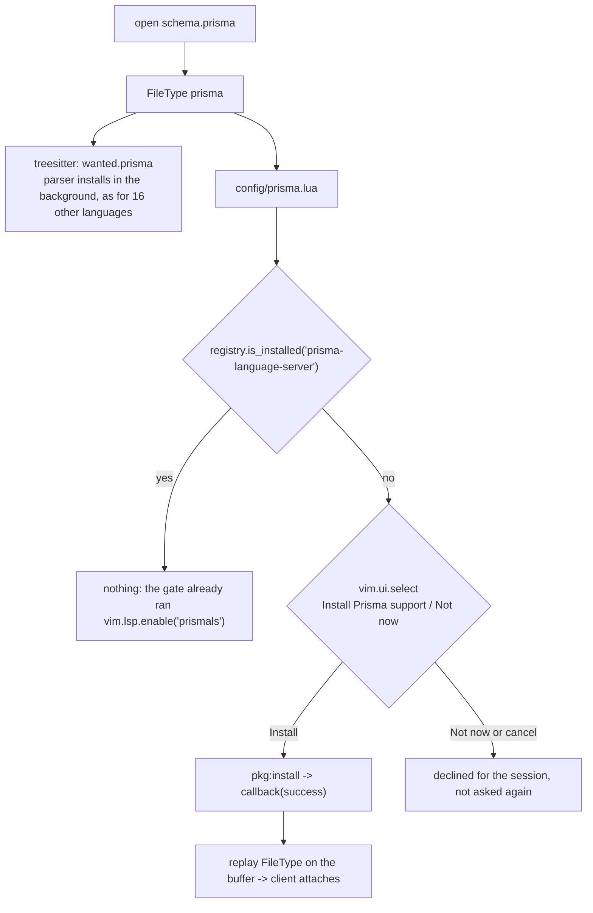

# PLAN — Prisma support in the nvim config

## Goal
A `.prisma` buffer gets treesitter highlighting, and the Prisma language server
(completion, diagnostics, hover, go-to-definition, format on save) once the
server is installed. Nothing is installed behind the user's back: the npm
package is offered on first use and installed only on accept.

## Current state (researched, not assumed)
- `prisma-language-server` (mason) and the `prisma` treesitter parser are
  already on this machine, installed by hand at 01:16 and 01:17 today
  (`mason.log`, `site/parser/prisma.so`).
- Nothing in the config declares either, and `mason-lspconfig` runs with
  `automatic_enable = false`, so no `prismals` client has ever attached
  (`lsp.log` has no line for it).
- Filetype detection needs no work: Neovim's runtime maps `.prisma` to filetype
  `prisma`, and `vim.filetype.match({ filename = 'schema.prisma' })` returns
  `prisma` in a clean headless run.
- Enabling a server whose binary is missing is quiet: with a fake `cmd` the run
  attached 0 clients, printed nothing and wrote no `lsp.log` line. Leaving
  `prismals` enabled while uninstalled is therefore safe.
- `vim.lsp.enable` registers its own `FileType` autocmd (`vim/lsp.lua:646`), so
  replaying `FileType` on a buffer after an install is what starts the client.
- `mason-registry` gives `is_installed(name)` and `get_package(name)`, and
  `Package:install(opts, callback)` takes `fun(success, error)`.
- The treesitter lazy path installs silently: `FileType` looks the language up
  in `wanted`, calls `nvim-treesitter.install`, polls for the parser and
  replays `FileType`. There is no prompt in it, and the config has no other
  prompt except `nontext.lua`'s `vim.ui.select` for non-text files.

## Approach
Prompt for the npm install, let the parser follow the existing silent path.

## Changes
| File | Change |
|---|---|
| `lua/plugins/lsp.lua` | `'prismals'` in the `gate.gate` loop, and `require('config.prisma').setup()` |
| `lua/config/prisma.lua` | new: first-use prompt, install, `FileType` replay |
| `lua/plugins/treesitter.lua` | `prisma = true` in `wanted` |

## Decisions
- `prismals` stays out of `ensure_installed`, which is the eager list: the npm
  package is the heavy, network-fetching action, so it asks first. This is the
  one place the config deviates from "declare every server up front".
- The parser keeps the silent lazy path: it is a grammar compile on the route
  every other language already takes, and the alternative (prompt owns both)
  would have to reimplement the poll-and-replay that `wanted` already does.
- Server name `prismals` in the gate loop, not the package name: the registry
  spec for `prisma-language-server` declares `neovim.lspconfig = "prismals"`.
- Goes into the existing gate loop, next to `ts_ls`: prismals has no memory
  guard and no launch details, and the loop already gives it the large-file
  block from `config/lsp_gate.lua`.
- Formatting comes from the server through conform's existing
  `lsp_format = 'fallback'`, with the prisma-fmt the server bundles. Rejected: a
  conform `prisma` formatter, because conform ships none and `prisma-fmt` is not
  a mason package.
- Decline memory is session-scoped (a flag in the module), so the prompt
  returns on the next start. A marker file under `stdpath('state')` is the
  alternative if it should never ask twice.
- Cancel counts as decline, so leaving the prompt with `Esc` does not re-ask on
  the next buffer.
- The attach after an install goes through `vim.lsp.enable('prismals')`, not a
  replay of the global `FileType` event. `enable` replays its own
  `nvim.lsp.enable` FileType group (`vim/lsp.lua:656`), while the global event
  re-enters the prompt autocmd: the first draft hit
  `E218: Autocommand nesting too deep` in the stubbed accept test.
- No filetype autocmd for detection and no README section: the runtime detects
  `.prisma`, and the README documents keymaps and previews, not servers.

## Risks
- The first schema on a machine without the server opens without one for as long
  as npm takes. Accepted, and it is the point of asking.
- `ensure_installed` still installs ten servers eagerly on a fresh machine, so
  prisma being lazy does not save general startup work. Making the whole list
  lazy is a separate epic.
- prismals resolves its root from `root_markers = { '.git', 'package.json' }`,
  so a loose `.prisma` file outside a repo or package gets no client. Same rule
  as every other gated server.
- Found while reading, unrelated: `get_capabilities()` in `after/plugin/lsp.lua`
  is defined and never called, so every server starts with Neovim's default
  capabilities instead of blink's. One line, not part of this epic.

## Verification
- Headless load of the three changed files, then a full config start.
- `vim.lsp.config['prismals']` resolves, and a `schema.prisma` in a git fixture
  attaches a `prismals` client.
- Prompt path with the registry stubbed: accept calls `install` once and
  replays `FileType`; decline and cancel prompt once and then stay quiet.
- `conform` with `lsp_format = 'fallback'` formats a misformatted schema.
- The bats suites are untouched by this change; run them once at the end.
